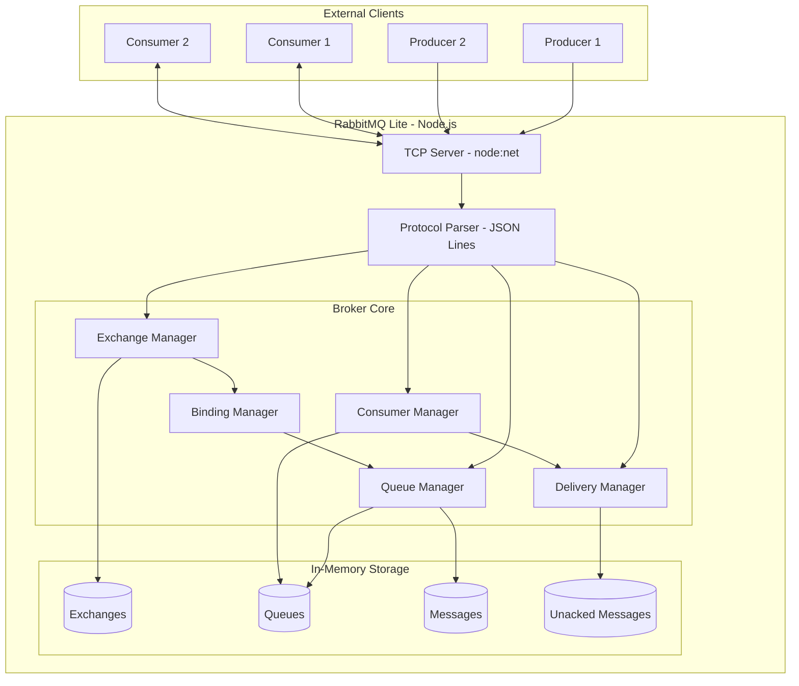
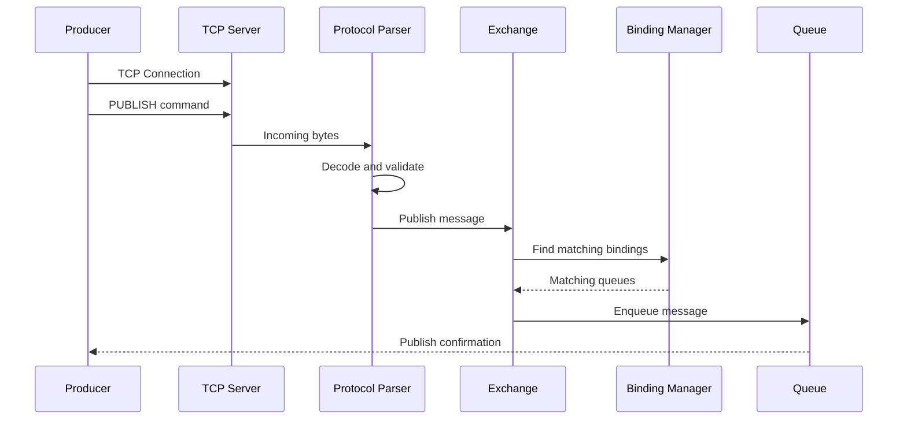
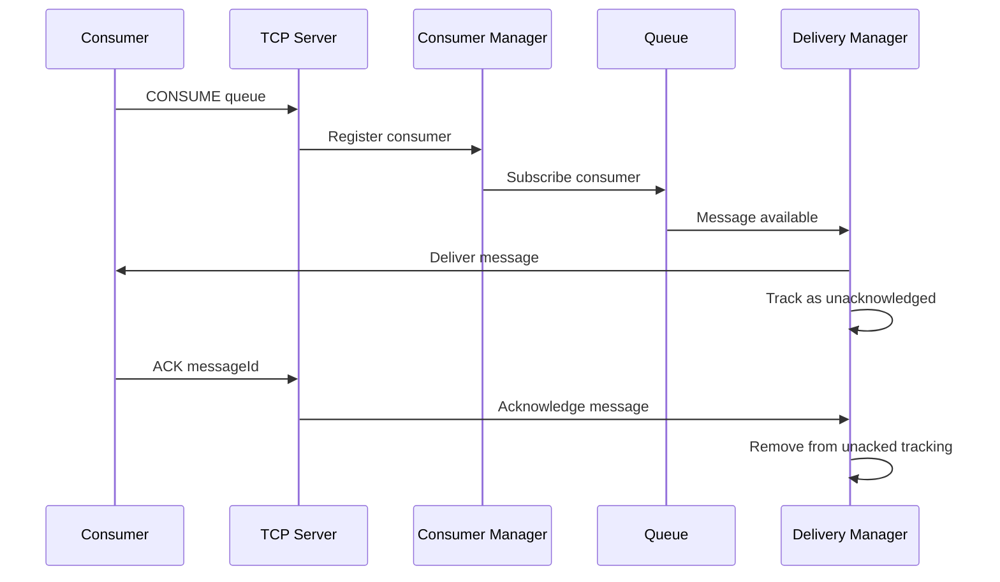

# RabbitMQ Lite — Architecture & Development Roadmap

A lightweight, RabbitMQ-inspired message broker built from scratch using Node.js and TypeScript.

The goal is to understand message broker internals, TCP networking, message routing, queue management, acknowledgements, persistence, and backpressure.

> This is a learning implementation with a custom protocol, not an AMQP-compatible RabbitMQ replacement.

---

## 1. High-Level Architecture



## 2. Message Publishing and Routing



## 3. Message Consumption and Acknowledgement



## 4. Project Structure

```text
rabbitmq-lite/
│
├── src/
│   ├── server/
│   │   └── tcp-server.ts
│   │
│   ├── protocol/
│   │   ├── commands.ts
│   │   ├── parser.ts
│   │   └── frame.ts
│   │
│   ├── broker/
│   │   ├── broker.ts
│   │   ├── exchange.ts
│   │   ├── binding.ts
│   │   ├── queue.ts
│   │   ├── consumer.ts
│   │   └── delivery.ts
│   │
│   ├── types/
│   │   └── message.ts
│   │
│   └── index.ts
│
├── tests/
│   ├── exchange.test.ts
│   ├── queue.test.ts
│   └── broker.test.ts
│
├── benchmarks/
│   └── publish.ts
│
├── package.json
├── tsconfig.json
└── README.md
```

## 5. Core Components and Responsibilities

| Component | Responsibility |
|---|---|
| TCP Server | Accept and manage client connections |
| Protocol Parser | Decode and validate incoming commands |
| Broker | Coordinate broker operations |
| Exchange Manager | Manage exchanges and routing |
| Binding Manager | Map exchanges to queues using routing keys |
| Queue Manager | Create and manage queues |
| Queue | Store pending messages |
| Consumer Manager | Register and manage consumers |
| Delivery Manager | Deliver messages and track acknowledgements |

### Important Architectural Boundaries

- TCP Server should not contain broker business logic.
- Protocol Parser should not know how queues are implemented.
- Exchange should handle routing, not message consumption.
- Queue should manage message storage and ordering.
- Consumer Manager should manage consumer registration and lifecycle.
- Delivery Manager should handle delivery state, ACK and redelivery.
- Business processing must happen inside external consumer applications.

## 6. Core Data Models

### Message

```typescript
interface Message {
  id: string;
  exchange: string;
  routingKey: string;
  content: Buffer;
  timestamp: number;
  redelivered: boolean;
}
```

### Exchange

```typescript
type ExchangeType = "direct";

interface Exchange {
  name: string;
  type: ExchangeType;
  bindings: Binding[];
}
```

### Binding

```typescript
interface Binding {
  exchange: string;
  queue: string;
  routingKey: string;
}
```

### Queue

```typescript
interface Queue {
  name: string;
  messages: Message[];
  consumers: Consumer[];
  bindings: Binding[];
}
```

### Consumer

```typescript
interface Consumer {
  id: string;
  queue: string;
  connectionId: string;
  unackedMessages: Map<string, Message>;
}
```

These are initial conceptual models. Their internal representations may evolve as performance and reliability requirements grow.

## 7. Initial Communication Protocol

Initially, use JSON Lines over TCP.

Each command is a JSON object terminated by a newline (`\n`).

### Declare Queue

```json
{
  "type": "QUEUE_DECLARE",
  "queue": "order-processing"
}
```

### Declare Exchange

```json
{
  "type": "EXCHANGE_DECLARE",
  "exchange": "orders",
  "exchangeType": "direct"
}
```

### Bind Queue

```json
{
  "type": "QUEUE_BIND",
  "exchange": "orders",
  "queue": "order-processing",
  "routingKey": "order.created"
}
```

### Publish Message

```json
{
  "type": "PUBLISH",
  "exchange": "orders",
  "routingKey": "order.created",
  "content": {
    "orderId": "123"
  }
}
```

### Consume Messages

```json
{
  "type": "CONSUME",
  "queue": "order-processing"
}
```

### Acknowledge Message

```json
{
  "type": "ACK",
  "messageId": "msg-123"
}
```

> TCP is a byte stream, not a message-oriented protocol. The parser must handle fragmented messages, multiple commands in a single data event, and incomplete frames.

## 8. Development Roadmap

### Phase 1 — TCP Server and Protocol

- [ ] Start TCP server on port 5672.
- [ ] Accept multiple client connections.
- [ ] Parse JSON Lines.
- [ ] Respond to PING with PONG.
- [ ] Handle multiple commands on one connection.
- [ ] Handle fragmented TCP data.
- [ ] Handle multiple commands in one TCP packet.
- [ ] Handle malformed JSON without crashing.
- [ ] Clean up disconnected clients.

**Acceptance criteria:** Two independent TCP clients can connect and reliably exchange commands.

### Phase 2 — Queue Engine

- [ ] Declare queues.
- [ ] Publish messages directly to queues.
- [ ] Store messages in memory.
- [ ] Implement FIFO retrieval.
- [ ] Support multiple queues.
- [ ] Write unit tests for queue operations.

### Phase 3 — Exchange and Routing

- [ ] Implement direct exchanges.
- [ ] Create queue bindings.
- [ ] Route messages using routing keys.
- [ ] Support multiple bindings.
- [ ] Handle unroutable messages.

### Phase 4 — Consumer Engine

- [ ] Register consumers.
- [ ] Subscribe consumers to queues.
- [ ] Push messages to consumers.
- [ ] Support multiple consumers per queue.
- [ ] Implement round-robin delivery.
- [ ] Handle consumer disconnections.

### Phase 5 — Acknowledgements and Redelivery

- [ ] Implement manual ACK.
- [ ] Track unacknowledged messages.
- [ ] Remove acknowledged messages.
- [ ] Requeue messages after consumer disconnection.
- [ ] Implement redelivery tracking.
- [ ] Prevent duplicate ACK processing.

### Phase 6 — Persistence and Recovery

- [ ] Implement append-only message logs.
- [ ] Introduce a write-ahead log (WAL).
- [ ] Persist queue metadata.
- [ ] Recover queues after restart.
- [ ] Recover pending messages.
- [ ] Handle partially written log records.

### Phase 7 — Performance and Backpressure

- [ ] Benchmark publishing throughput.
- [ ] Measure delivery latency.
- [ ] Test concurrent producers.
- [ ] Test concurrent consumers.
- [ ] Implement consumer prefetch limits.
- [ ] Implement backpressure.
- [ ] Measure memory consumption.
- [ ] Identify bottlenecks and optimize.

## 9. Technology Stack

| Area | Technology |
|---|---|
| Runtime | Node.js |
| Language | TypeScript |
| Package Manager | pnpm |
| Networking | node:net |
| Protocol | Custom JSON Lines |
| Validation | Zod |
| Logging | Pino |
| Testing | Vitest |
| Benchmarking | node:perf_hooks |
| Compilation | TypeScript Compiler |
| Development | tsx |

## 10. Performance Metrics

The broker should eventually expose the following metrics:

| Metric | Purpose |
|---|---|
| Messages/sec | Publishing and delivery throughput |
| p50 latency | Typical message latency |
| p95 latency | High-percentile latency |
| p99 latency | Tail latency |
| Queue depth | Number of pending messages |
| Unacked count | Messages awaiting acknowledgement |
| Memory usage | Memory efficiency |
| CPU usage | Processing overhead |
| Active connections | Connected clients |

Benchmarks should use reproducible workloads and clearly document message size, producer count, consumer count, acknowledgement mode, and persistence settings.

## 11. Final Project Goals

By the end of this project, the broker should support:

- Multiple concurrent producer connections.
- Multiple concurrent consumer connections.
- Direct exchange-based routing.
- Multiple queues and bindings.
- FIFO message storage.
- Push-based message delivery.
- Round-robin consumer distribution.
- Manual acknowledgements.
- Redelivery after consumer disconnection.
- Message persistence and recovery.
- Backpressure and prefetch.
- Performance benchmarks.

## 12. Engineering Principles

1. Build incrementally. Each phase must have working tests.
2. Keep networking, protocol handling, and broker logic separate.
3. Avoid premature optimization.
4. Prefer simple data structures initially, then benchmark alternatives.
5. Test failure scenarios, not just successful message delivery.
6. Document design decisions and known limitations.
7. Compare performance against RabbitMQ using equivalent workloads.
8. Don't use an existing message broker internally. The broker itself is what we're building.

---

**First milestone:** Build a TCP server that accepts multiple clients and reliably handles PING/PONG commands using a custom JSON Lines protocol.

**Project:** `rabbitmq-lite`  
**Language:** TypeScript  
**Runtime:** Node.js  
**Architecture:** Single-node, initially in-memory message broker
